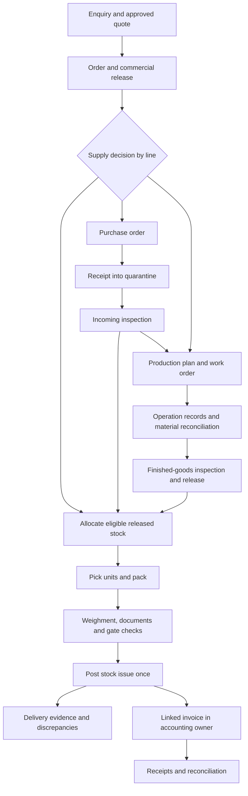
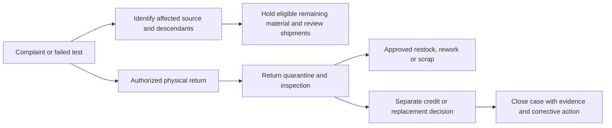

# JNB Steel standard system: scope and page plan

Prepared 7 November 2026. Status: proposed scope for review, based on desk research and the current demo. Plant procedures, volumes, systems and commercial terms still require discovery.

## 1. Recommended scope

Build around **sales, procurement, traceable material, quality, production, dispatch and financial reconciliation**. For a manufacturer, an order/stock/dispatch tracker is the first operational slice; it becomes a complete manufacturing system only when actual production, WIP, material genealogy and quality release are controlled too.

JNB's public product range includes stainless steel coils, pipes/tubes and wires, and its site lists multiple plants. This supports a product-family and plant-aware design. It does not establish every process performed at each plant or its present software. [JNB products and locations](https://www.jnbsteel.com/product/)

This plan proposes a stainless steel conversion/manufacturing and distribution system. Melt-shop, casting and other primary steelmaking modules enter scope only if discovery establishes those operations. ERP documentation provides workflow benchmarks, not a vendor choice or evidence of JNB's installed systems. The research evidence and limits are recorded in [RESEARCH_NOTES.md](RESEARCH_NOTES.md).

### Scope size

| Scope | Logical screens/workspaces | Interpretation |
| --- | ---: | --- |
| R1 operations | 43 | Sales, purchasing, receiving, stock, QC, dispatch, finance handoff and platform controls |
| R2 manufacturing | 20 | Planning, execution, genealogy, WIP, yield, inspection and plant support |
| Internal target | **63** | Includes **7 upgrades to existing functional screens** and **56 new screen/workspace definitions** |
| Conditional expansion | 12 | Dealer/supplier access, exports, customer-owned processing, hardware and advanced functions |
| Full catalog ceiling | **75** | Planning inventory, not a recommendation to build every item immediately |

The current demo has nine pages: seven functional screens plus overview and page map. The two demo-guide pages are excluded from the business-system count. Existing screens need substantial upgrades; they are not production-ready components merely because they are already visible.

**A catalog row is a logical workspace, not necessarily a separate HTML file or a separately priced page.** List/detail templates, tabs, dialogs and report views can share implementation. These are planning counts, not an effort estimate. Manufacturing routes and conditional functions may reduce or change the selected scope. If a conditional workflow is actually used, its controls become required for that workflow.

Use the [detailed page catalog](PAGE_CATALOG.csv) to review each screen's proposed route, users, fields, actions, dependencies, acceptance check and applicability. Routes are future application suggestions, not existing links.

## 2. What the current demo needs next

| Current behavior | Standard-system requirement | Main catalog IDs |
| --- | --- | --- |
| Product family and SKU-level kg totals | Controlled grade, dimensions, finish and specification; individual heat/lot/coil/bundle identity | CORE-04, 05, 24 |
| Simple receive-quantity dialog | PO-linked goods receipt, source documents, discrepancies, quarantine and incoming QC | CORE-19, 20, 21 |
| Single allocation action | Lot-aware partial reservations, quality eligibility, concurrency and release history | CORE-16, 23, 29 |
| Recent movement feed | Complete auditable stock ledger, controlled counts, transfers and opening balances | CORE-26, 27, 28, 43 |
| Order and dispatch statuses | Separate commercial, production, QC, fulfilment, billing and payment states | CORE-15, 32, 35, 36; MFG-03 |
| Manual dispatch details and gross weight | Picked units, packing, actual net/tare/gross evidence, gate authorization and delivery discrepancies | CORE-33, 34, 32 |
| Illustrative CSV downloads | Approved document templates, source certificates, accounting references and applicable statutory identifiers | CORE-30, 35, 40, 41 |
| Browser storage and role preview | Shared backend, server-enforced permissions, approval limits, transactional posting and audit trail | CORE-01, 03, 10, 12 |
| No production records | Work orders, operation records, material consumption, WIP, output, scrap and inspection | MFG-01 through 20 as applicable |

## 3. Navigation and page inventory

Keep navigation organized by work. Do not expose 75 equal sidebar links.

| Navigation group | Contents |
| --- | --- |
| Home | Role dashboard, my tasks, approvals and alerts |
| Sales | Customers, enquiries/quotes, orders, promises and complaints |
| Purchase | Suppliers, material requests, POs, supplier returns |
| Material | Receiving, stock, allocations, units/lots, movements, transfers, counts |
| Production | Plan, work orders, job cards, WIP, output and external processing |
| Quality | Inspection queues, holds, traceability, nonconformance and certificates |
| Dispatch | Loads, picking/packing, weighment, gate release and delivery evidence |
| Finance | Invoices, matching, receivables, payables, credit and statutory-document status |
| Reports | Role-scoped operational reports and reconciliation exceptions |
| Administration | Masters, access, rules, imports, integrations and audit |

Role and site scope determine visible workspaces. A user with access to several groups gets one shared record, not duplicate order or stock records in each group.

### R1 Operations

| ID | Screen/workspace | Priority | Existing coverage |
| --- | --- | --- | --- |
| CORE-01 | Sign in and access | Essential | New |
| CORE-02 | Role dashboard | Essential | Upgrade existing: dashboard |
| CORE-03 | My tasks and approvals | Essential | New |
| CORE-04 | Product catalog and variant detail | Essential | New |
| CORE-05 | Specifications, units and controlled lists | Essential | New |
| CORE-06 | Customer directory | Essential | Upgrade existing: customers |
| CORE-07 | Customer account detail | Essential | New: current demo only links to order history |
| CORE-08 | Supplier directory and detail | Essential | New |
| CORE-09 | Company, plant, warehouse and bin setup | Essential | New |
| CORE-10 | Users, roles and approval limits | Essential | New: current role switch is a preview only |
| CORE-11 | Business rules and document settings | Essential | New |
| CORE-12 | Audit trail and document revisions | Essential | New |
| CORE-13 | Enquiries and quotation workspace | Standard | New |
| CORE-14 | Sales orders | Essential | Upgrade existing: orders |
| CORE-15 | Sales order detail and amendments | Essential | Upgrade existing: order detail |
| CORE-16 | Allocation and reservation board | Essential | New: current order has one allocation action |
| CORE-17 | Promise and shortage planning | Standard | New: dashboard only shows promise dates |
| CORE-18 | Material requirements and purchase requests | Standard | New |
| CORE-19 | Supplier quotes and purchase orders | Essential | New |
| CORE-20 | Goods receipt workspace | Essential | New: demo has a simple quantity receipt dialog |
| CORE-21 | Incoming inspection | Essential | New |
| CORE-22 | Supplier returns and purchase claims | Standard | New |
| CORE-23 | Stock overview and availability | Essential | Upgrade existing: stock |
| CORE-24 | Heat, lot, coil and bundle detail | Essential | New |
| CORE-25 | Forward/backward traceability | Essential | New |
| CORE-26 | Stock ledger and movement detail | Essential | New: current demo shows only recent movements |
| CORE-27 | Transfers and transit receipts | Essential | New |
| CORE-28 | Physical count and stock adjustment | Essential | New |
| CORE-29 | Quality holds and release | Essential | New |
| CORE-30 | Supplier certificates and document repository | Essential | New |
| CORE-31 | Dispatch board | Essential | Upgrade existing: dispatches |
| CORE-32 | Dispatch detail and delivery evidence | Essential | Upgrade existing: dispatch detail |
| CORE-33 | Picking, packing and label workspace | Essential | New |
| CORE-34 | Weighment and gate release | Essential | New: demo stores only manual gross weight |
| CORE-35 | Sales invoices and credit/debit documents | Essential | New: current exports are illustrative order/dispatch CSVs |
| CORE-36 | Receivables, customer receipts and credit control | Essential | New |
| CORE-37 | Purchase invoices and three-way matching | Essential | New |
| CORE-38 | Payables and supplier payment allocation | Essential | New |
| CORE-39 | Customer returns and complaint cases | Essential | New |
| CORE-40 | Statutory and transport-document workbench | Essential where applicable | New |
| CORE-41 | Integrations, outbox and reconciliation | Essential | New |
| CORE-42 | Operational reports and exceptions | Essential | New: current dashboard is a small preview |
| CORE-43 | Data import and opening-balance workbench | Essential | New |

### R2 Manufacturing

| ID | Screen/workspace | Priority | Existing coverage |
| --- | --- | --- | --- |
| MFG-01 | Production plan and capacity board | Essential for manufacturing | New |
| MFG-02 | Work orders | Essential for manufacturing | New |
| MFG-03 | Work order detail and material genealogy | Essential for manufacturing | New |
| MFG-04 | BOM, process routing and specification revisions | Essential for manufacturing | New |
| MFG-05 | Operator job cards and shift entry | Essential for manufacturing | New |
| MFG-06 | WIP, material issues and unused returns | Essential for manufacturing | New |
| MFG-07 | Coil slitting and cut-to-length batch sheet | Route dependent | New |
| MFG-08 | Tube and pipe production batch sheet | Route dependent | New |
| MFG-09 | Wire processing and spool/bundle batch sheet | Route dependent | New |
| MFG-10 | Output, yield, scrap and remnant reconciliation | Essential for manufacturing | New |
| MFG-11 | Outward job-work and subcontract processing | Conditional | New |
| MFG-12 | In-process and finished-goods inspection workbench | Essential for manufacturing | New |
| MFG-13 | Nonconformance, rework and corrective action | Essential for manufacturing | New |
| MFG-14 | Issued test certificates and controlled revisions | Essential where certificates supplied | New |
| MFG-15 | Finished-goods and dispatch release queue | Essential for manufacturing | New |
| MFG-16 | Machine, station and tooling master | Standard for manufacturing | New |
| MFG-17 | Breakdown and preventive maintenance jobs | Standard for manufacturing | New |
| MFG-18 | Instruments and calibration | Essential where measurement controls apply | New |
| MFG-19 | Conversion cost and WIP valuation reconciliation | Standard for manufacturing | New |
| MFG-20 | Inspection plans and method/specification revisions | Essential for manufacturing | New |

### Optional expansion

| ID | Screen/workspace | Priority | Existing coverage |
| --- | --- | --- | --- |
| OPT-01 | Dealer account dashboard | Optional | New |
| OPT-02 | Dealer order request and reorder | Optional | New |
| OPT-03 | Dealer documents and delivery evidence | Optional | New |
| OPT-04 | Supplier RFQ and PO acknowledgment | Optional | New |
| OPT-05 | Customer-owned material and inward processing | Conditional | New |
| OPT-06 | Export order and shipping-document workspace | Conditional | New |
| OPT-07 | Intercompany movement and billing | Conditional | New |
| OPT-08 | Blanket contracts and schedule releases | Optional | New |
| OPT-09 | Automatic cutting/slitting optimization | Optional | New |
| OPT-10 | Scan-first mobile terminal | Optional | New |
| OPT-11 | Hardware connector and device-health console | Optional | New |
| OPT-12 | OEE, energy and advanced performance | Optional | New |

## 4. Data model that makes the pages work

### Material identity and units

Keep these separate:

- **Product variant:** family, grade, shape, dimensions, finish, condition and applicable specification revision.
- **Source heat/batch:** supplier identity, source heat number, received batch and certificates. A heat can cover several physical units; do not invent one heat per SKU.
- **Handling unit:** a uniquely labeled coil, bundle, spool or other agreed physical unit, with actual quantity, location, owner and disposition.
- **Transformation:** the actual relationship between consumed input units and resulting output units, including split, merge, rework and remnant events.

The catalog also distinguishes purchased raw material, intermediate material, finished products, packing/consumables, maintenance spares, reusable remnants and scrap. Track only the attributes and secondary units relevant to each class. Suppliers, outside processors and transporters can share a party master while retaining their different approvals and roles.

Store actual kg together with required secondary measures such as pieces, metres or spools. Keep theoretical weight separate from measured weight. Product-specific conversions and rounding must be controlled; a single fixed kg-per-piece factor is unsuitable for every size and actual-length combination. Quotation, purchase and invoice rate bases must remain explicit, including kg/tonne/piece/metre conversion.

Required relationships include customer order line/schedule to allocation, allocation to material unit, receipt to PO/source documents, work order operation to actual input/output units, dispatch line to picked unit/order line, invoice line to delivery/credit reference, and payment allocation to invoice. Capture document revisions and stable internal IDs even when external reference numbers change.

### Inventory, quality and ownership

Track legal entity, plant, warehouse/bin, ownership and quality disposition separately. Quarantine, released, held, rejected, WIP, scrap and transit must be identifiable. A warehouse label alone must not imply a quality approval. Customer-owned material must not inflate owned stock or valuation.

Use an append-only posting model with controlled reversals. Every movement records source document, unit/lot, quantity/UOM, location, actor, time, reason and reversal link. Corrections preserve the original event. Agree posting periods and backdating permissions with finance.

For a given eligible unit/location:

```text
Free to allocate = released, physically present, owned on-hand
                   minus active reservations against that same stock
```

Picking and staging continue the same reservation; they are not a second deduction from free stock. Quarantine, transit and customer-owned material are excluded. Planned production and expected receipts are future supply, not dispatch-ready stock. A hold placed after reservation must stop affected picking/gate release and trigger review of reservations and descendants.

Choose exactly one authoritative stock-issue event, for example the approved gate-released delivery note. Order confirmation, reservation and draft dispatch do not issue stock. A later invoice must not issue it again. The event choice must align with the selected ERP/accounting design and approved operating policy.

Reconcile material net weight separately from vehicle tare/gross/net load and packaging weight. A weighbridge's net load need not equal billable metal kg when packing or other items are present. Record the agreed measurement and billing basis, reweigh history, scale tolerance and authorized variance decision rather than silently replacing bundle weights.

Server transactions, concurrency controls and idempotency keys protect allocation and posting. Two users cannot reserve the same remaining coil. A retry after a timeout cannot create a second goods issue, invoice or external document.

### Manufacturing genealogy and quantity reconciliation

Record actual input/output links at the operation where transformation occurs. For a many-input/many-output run, preserve the actual material mapping where known; if only batch-level mixing is known, report that limitation and the conservative affected batch. Do not imply exact individual genealogy merely because inputs and outputs share one work order. This distinction follows the traceability limitation described in the [ERPNext traceability documentation](https://docs.frappe.io/erpnext/serial-and-batch-traceability-report).

Each processing stage reconciles mutually exclusive quantity buckets:

```text
Opening unfinished WIP + actual input issued - unused input returned
  = accepted finished output
  + completed output awaiting disposition/rework
  + reusable remnants
  + recoverable scrap
  + authorized process loss
  + closing unfinished WIP
```

Completed held output and unfinished WIP cannot contain the same material. Record the location and ownership of every physical bucket. A reusable remnant retains its identity, dimensions, weight and origin; scrap has a grade/category, quantity and authorized disposition. Unexplained variances need investigation and approval, not an automatic loss percentage. Job cards and separate by-product inventory are useful implementation benchmarks. [ERPNext job cards](https://docs.frappe.io/erpnext/job-card), [Odoo by-products](https://www.odoo.com/documentation/18.0/applications/inventory_and_mrp/manufacturing/workflows/byproducts.html)

Record destructive-test samples as controlled consumption with their test reference and approved quantity category; do not hide them as unexplained loss. A held unit can enter an expressly approved rework/test route without becoming eligible for ordinary production use or customer dispatch.

Illustrative reconciliation only: 1,000 kg input becomes 900 kg accepted output, 50 kg reusable remnant, 40 kg recoverable scrap and 10 kg authorized loss. This is arithmetic for a test case, not an industry yield target. If only 600 kg has been processed and 400 kg remains WIP, the unfinished balance is not production loss.

## 5. End-to-end workflows



The diagram shows operational relationships, not a universal legal document sequence. Finance must agree invoice, transport-document and goods-movement timing for the actual transaction type.

### A. Sell from available stock

1. Capture customer PO, ship-to, approved quote/specification revision, quantity/rate basis and delivery schedules.
2. Check account status, agreed credit exposure and commercial approvals. Confirm the order revision.
3. Reserve specific eligible units or partial quantities. Substitution of grade/size/finish requires explicit review.
4. Pick by label; record bundle contents, packing and actual quantity. Control permissible variation and any required customer approval.
5. Validate QC/certificates, credit release, weight evidence and applicable documents before gate authorization.
6. Post the stock issue once. Capture dispatch and delivery evidence, shortage/damage exceptions and remaining order quantities.
7. Create/reconcile invoices and receipts through the agreed accounting owner.

Use separate line-level quantities for ordered, cancelled, reserved, shipped, delivered and billed. The open shipping balance equals ordered less approved cancellations less effective posted dispatches, including controlled reversals. A return does not silently reopen the old order: replacement supply or credit is an explicit linked decision. Billing and payment states do not overwrite shipping state.

### B. Buy to fulfil demand

Consolidate uncovered requirements without duplicating firm supply. Compare supplier quotes, approve a PO and record line schedules. Receive each actual lot/unit against the PO, capture supplier challan, weights and source MTC, and quarantine material needing inspection. QC can release part and hold/reject the balance. Match the supplier invoice to the PO and accepted receipt using approved tolerances. Track physical supplier returns separately from credit settlement.

### C. Manufacture or convert

Plan capacity and materials against confirmed demand and approved stock targets. Release a work order with frozen routing/specification revisions and eligible source material. Operators record actual inputs, output units, operation times, stoppages and measurements. Supervisors reconcile WIP, remnant, scrap and loss; QC releases output against the applicable inspection plan. Only released finished units become eligible for dispatch.

Validate routes with JNB before configuring them. Examples to discuss, not confirmed JNB routing:

| Product route | Example records to confirm |
| --- | --- |
| Coil conversion | Parent coil, slit/cut plan, actual child coils/sheets, dimensions, remnants and scrap |
| Pipe/tube | Source strip/coil, forming/welding or actual production method, sizing/cutting, inspection, bundle identity |
| Wire | Input coil/rod, actual drawing/treatment sequence, gauges, output spool/bundle, inspection and weight |

Enable only operations actually performed. Inspection plans define tests, methods, sample frequency, limits and release authority from approved specifications/customer requirements. Software must not invent metallurgical acceptance criteria. Incoming, in-process and outgoing inspection are separate controlled checkpoints. [ERPNext quality-inspection benchmark](https://docs.frappe.io/erpnext/quality-inspection)

### D. Transfers and external processing

An inter-warehouse/plant transfer has source issue, stock in transit and destination receipt, including partial receipt and variance investigation. Confirm whether the movement crosses a legal entity/registration before selecting financial and transport documents.

Outward processing tracks JNB-owned material at the processor, expected returns, actual processed output/scrap, service charges and overdue balances. Customer-owned inward processing uses a separate ownership ledger and service-billing flow. Neither should be modeled as an ordinary stock purchase and resale. Their catalog placement is conditional; their controls are mandatory when used. [Outward subcontracting](https://docs.frappe.io/erpnext/subcontracting), [inward subcontracting](https://docs.frappe.io/erpnext/subcontracting-inward)

### E. Complaint, containment and return



Trace affected inventory and delivered customers even when no physical return has yet arrived. Link complaint evidence, disposition, credit and any replacement order; retain original dispatch and certificate history. Never restock a returned bundle directly into released availability without its required inspection.

## 6. Roles, approval boundaries and audit

| Role | Main workspace | Approval boundary |
| --- | --- | --- |
| Owner/management | Exceptions, promises, margins and approvals | Assigned commercial/financial limits; overrides require reason and audit |
| Sales | Customers, quotes, orders and commitments | Cannot release QC holds, edit posted stock or fabricate payment clearance |
| Purchase | Suppliers, requirements, POs and claims | PO approval limits; bank-detail changes require separate review |
| Store/receiving | Receipts, units, allocation, counts and transfers | Cannot approve own stock write-off or self-release QC material |
| Planner | Supply/capacity plan, work orders and priorities | Cannot turn planned production into released physical stock |
| Production supervisor | Work release, output reconciliation, shift review | Material variances/rework follow approved limits |
| Operator | Assigned job cards, actual quantities and readings | Restricted to assigned stations/jobs; no unrestricted master edits |
| QC inspector/approver | Inspection, holds, methods and certificates | Release/signature authority explicitly assigned; high-risk overrides require independent approval |
| Dispatch/gate | Picking, packing, weights, release and delivery evidence | Cannot bypass unresolved QC, credit or required document blocks |
| Finance | Invoice matching, credit, payments and reconciliation | Financial posting periods, credit overrides and payments by assigned limits |
| System admin | Accounts, configuration and integrations | Technical access does not automatically grant commercial/QC approval |
| Auditor | Read-only scoped records and history | Export permission controlled separately |

Small teams may assign several roles to one person, but prohibited self-approval must still be enforced. Approvals bind to a document revision; changing quantity, specification, rate or other material fields invalidates affected approvals. Delegation has scope and expiry. Server permissions enforce site/entity access, including reports, exports, attachments and APIs.

## 7. Finance, documents and integrations

### Select a source of truth before development

Evaluate two workable approaches:

1. **Configure/extend a suitable ERP:** the ERP owns inventory and finance; custom screens use supported APIs and its posting rules.
2. **Custom operations plus existing accounting:** the operations service owns the physical material ledger; the selected accounting system owns financial books. Approved document exchange and stock-value/quantity reconciliation connect them.

Choose after checking actual software, licensing, installed versions, workflow fit and integration access. Do not operate two independently editable stock ledgers or two independently editable financial books. The custom interface can show external invoices and balances without becoming a new general ledger.

If TallyPrime is actually used, its official XML/HTTP integration is an option to assess, subject to installation and company configuration. The presence of integration documentation does not establish a ready connector. [Tally integration](https://help.tallysolutions.com/xml-integration/), [prerequisites](https://help.tallysolutions.com/pre-requisites-for-integrations/)

| Data/document | Proposed ownership decision |
| --- | --- |
| Customer/supplier/product masters | Choose one editing owner; map stable external IDs and approve duplicate merges |
| Orders, lots, reservations, work records | Selected operations/ERP owner; all consuming interfaces read the same records |
| Physical movements | Exactly one posting owner and event; finance receives reconciled references |
| Invoices, credits, receipts, payments, tax and GL | Selected accounting owner; application displays status and permitted actions |
| Supplier MTC/source files | Original attachment retained with source, unit/lot links and version history |
| JNB-issued test certificate | Controlled approved result revision, authorized signer and superseded/revoked state |
| IRN/e-way identifiers where applicable | Actual authorized-service outcome, acknowledged references and cancellation/error state |
| Weighbridge/instrument reading | Raw reading, device/operator/time, units and approved correction history |

Credit exposure must have an agreed definition: receivables, valid credits/advances and open-order/dispatch commitments as selected by policy, without counting the same commitment twice. A stale finance sync must be visible and must not silently clear a credit block. [Credit-control benchmark](https://docs.frappe.io/erpnext/credit-limit)

Three-way purchasing controls compare approved PO, accepted receipt and invoice, with quantity/rate/tax/freight tolerances and explicit exceptions. Finance owns posting and settlement. Goods movement and commercial credit/debit documents remain linked but separate.

### Statutory and transport-document scope

Confirm legal entities, registrations, transaction types and applicability with JNB's finance team. The plan does not assume turnover, tax rates, e-invoicing applicability or e-way bill thresholds. Rules need effective dates and current verification before activation. Dated portal advisories demonstrate why these settings cannot be frozen from a demo. [Authorized IRP advisory](https://einvoice6.gst.gov.in/content/revised-time-limit-for-e-invoice-reporting-for-businesses-with-aato-of-%E2%82%B910-crores-above/), [NIC portal updates](https://docs.ewaybillgst.gov.in/ewb.html)

The workbench should show draft, submitted, acknowledged, failed, cancelled and reconciliation-required states as applicable. An uploaded reference is visibly distinguished from a validated external response. A sample PDF must never imply a real government acknowledgement.

### Integration delivery

Start with a controlled manual/CSV-assisted handoff if automation is unavailable: reference mapping, responsible owner, validation and reconciliation remain necessary. Then automate agreed interfaces with an outbox, idempotent processing, retry policy, error queue and monitoring. For an unknown external outcome after timeout, query/reconcile before retrying a creation request. Hardware integrations, messaging, external portals and auto-optimization are separate scoped work; none is assumed connected in the present demo.

## 8. Reports and operational definitions

These are views under CORE-42 and related workspaces, not another set of top-level pages.

| Report | Definition and useful drill-down |
| --- | --- |
| Order book and promise adherence | Open kg by line/schedule; original and revised promise; actual dispatch/delivery; define the chosen service metric |
| Shortage and allocation age | Uncovered released demand, eligible free material, reservations and firm future supply shown separately |
| Stock by unit/location/disposition | Physical owned and third-party quantities, reservations, free quantities and ledger entries |
| Aging, remnant and WIP | Agreed aging start date, original versus last-movement age, usable dimensions, stage and unresolved quantities |
| Heat/lot trace and containment | Actual upstream/downstream links, affected units/dispatches/customers and traceability gaps |
| Production plan versus actual | Planned jobs/capacity, completed output, unfinished WIP, stoppages and schedule slippage |
| Yield and mass balance | Reconciled stage inputs/outputs, remnant, scrap, authorized loss and unexplained variance; define denominator |
| Scrap and rework | Quantity/value by grade, cause, operation and disposition; no mixing reusable remnant with scrap |
| Dispatch and delivery exceptions | Picked versus weighed versus posted kg, document blocks, POD pending, damage and buyer-acknowledged shortage |
| Receivables/payables and exposure | Finance-owned invoice due dates, credits, allocations and unallocated advances; last sync displayed |
| Document/integration reconciliation | Unbilled deliveries, unmatched supplier invoices, missing acknowledgements, duplicate/external failures |
| Inventory value and conversion cost | Reconciled to accounting policy, valuation method and authoritative finance balances; financial-data permission required |

Do not label a dispatch-derived value as revenue or profit. Financial margins require an agreed cost basis and posted finance data. OEE/energy analytics remain conditional until reliable run-time, downtime, rated-capacity and meter data exist.

## 9. Delivery phases and release gates

### P0: workflow discovery and design decisions

Walk one real order through purchasing/production, QC, dispatch and accounts at the selected plant. Review representative sanitized documents and sample data. Agree route maps, identity/label scheme, units, ownership, approval matrix, document/posting policies and the ERP-versus-custom approach. Establish volumes, device/connectivity limits and measurable pilot acceptance criteria.

**Gate:** named process owners approve the workflow and selected scope; data sources, document ownership and unresolved risks are recorded. Only then estimate effort, commercial price and dates.

### R1: operations foundation and controlled pilot

The 43-screen R1 catalog is an operations release envelope, not one small sprint. Deliver it in usable slices:

1. Access, masters, revisions, imports, document references and stock ledger foundation.
2. Customer order, PO/receipt, incoming QC, lot stock and allocation.
3. Pick/pack, weighment, approved stock issue, delivery evidence, invoicing handoff and reconciliation.
4. Complete the agreed exception flows: holds, transfers, counts, returns, payments/credit and reports.

Pilot one agreed plant, warehouse scope and representative product set. Financial screens may wrap the existing accounting owner rather than recreate accounting. Some capabilities can use supported existing ERP screens, but their controls and user ownership must be included in the scope.

**Gate:** pilot balances reconcile, permissions and concurrent posting work, physical labels match units, external documents reconcile, users complete the selected flows, and backup restoration has been demonstrated. If real manufacturing remains outside this release, describe R1 as an operations pilot and explicitly record how production balances are controlled meanwhile.

### R2: manufacturing completeness

Select one confirmed route first. Implement approved routing/specifications, work order, job cards, actual input/output identity, WIP, scrap/remnant reconciliation and QC release. Add relevant remaining product routes, costing, external processing and plant support after that vertical flow is proven.

**Gate:** demonstrate a source unit becoming several output units, partial work still in WIP, nonconformance/rework, backward/forward trace, dispatch of released output and finance reconciliation. A manufacturer is not fully covered while its actual production route remains unrecorded.

### R3: expansion driven by confirmed need

Roll out validated flows to additional plants; enable selected conditional modules, external access and automation. Exports, customer-owned processing or intercompany movement move earlier if those activities are part of the pilot. Optional does not mean their business controls can be omitted while those transactions are conducted.

Catalog dependencies describe data/workflow relationships and may be circular at the workspace level. They are not a ready-made chronological implementation schedule; build shared models and a complete transaction path before expanding menus.

## 10. Recommended next demo expansion

For the next client-facing prototype, add the following **12 logical screens** and upgrade the existing order detail, stock and dispatch views. This is a focused demo expansion, not the full production MVP.

| Order | Screen | Demonstration purpose |
| ---: | --- | --- |
| 1 | Product catalog, CORE-04 | Show grade, dimensions, finish and unit/rate basis |
| 2 | Enquiries/quotations, CORE-13 | Start from a customer requirement and preserve quote revision |
| 3 | Goods receipt, CORE-20 | Receive actual labeled material against a sample PO |
| 4 | Incoming inspection, CORE-21 | Hold and release quantities with sample results |
| 5 | Heat/lot/unit detail, CORE-24 | Connect physical labels, stock and source certificate |
| 6 | Stock ledger, CORE-26 | Explain the quantity behind an on-hand balance |
| 7 | Production plan, MFG-01 | Show an order-driven job and material/capacity need |
| 8 | Work order detail, MFG-03 | Demonstrate input, output, WIP, remnant and scrap reconciliation |
| 9 | Traceability, CORE-25 | Trace a dispatched bundle to its input and inspection evidence |
| 10 | Weighment/gate release, CORE-34 | Validate actual load and approval before issue |
| 11 | Invoice workspace, CORE-35 | Show linked illustrative billing without a second stock deduction |
| 12 | Customer receivables, CORE-36 | Show invoice balance, sample receipt and credit visibility |

Use one coherent fictional scenario from quotation to receipt/QC, material allocation or production, partial dispatch and invoice balance. Provide clearly labeled sample upstream records for purchase orders, specifications, certificates and approvals whose full workspaces are not yet demonstrated. Do not imply those dependencies have already been built. The current short video should be replaced only after the expanded story is stable.

Retain the shared Software Crafting design system, responsive list/detail patterns, accessible dialogs, consistent data and top attribution with client/page UTM parameters. A prototype role switch remains a role preview. Actual production authentication, integration and traceability claims require the backend described below.

## 11. Production architecture and nonfunctional work

The present static demo can continue as a sales artifact. A live operational system needs an authenticated service, transactional database, durable file storage, server validation and controlled background processing. Choose implementation technology after the ERP fit decision; no new frontend framework or cloud vendor is prescribed here.

Include these work items in estimates even though most are not pages:

- Server-enforced roles, site/entity scope, session controls, secure credentials and transport; sensitive exports and financial fields require explicit access.
- Transactional allocation/posting, fixed-precision quantity/money calculations, approved rounding and unit conversions; stable document IDs and idempotency.
- Attachment access, versioning, source integrity, controlled certificate issuance and malware/file-type checks as appropriate.
- Audit of posting, reversals, approvals, configuration, data imports and integration outcomes; controlled retention and archival policy.
- Monitoring, failed-job queues, backups and tested restores, deployment rollback, support ownership and incident procedures.
- Agreed recovery targets, concurrent users, record/document volume and performance budgets measured on real expected workloads.
- Responsive task-specific screens at phone/tablet/desktop sizes, keyboard and assistive-technology access, understandable validation and status/error recovery.
- Confirm shop-floor language, label format/printers, scanner type, connectivity and whether constrained offline capture is genuinely required. Offline financial/stock posting must not bypass server reconciliation.

Avoid unrequested custom payroll, full general ledger, banking, public website rebuild, AI pricing or automated material-testing claims. If a full accounting replacement or another enterprise function is requested, treat it as an additional evaluated scope, with the corresponding controls and migration.

## 12. Migration, training and operational cutover

1. Clean masters: customers, suppliers, product/specification variants, locations, tax/account mappings and external IDs. Resolve duplicates with an owner.
2. Inventory and label the opening stock by physical unit, actual kg, secondary quantity, location, ownership and QC disposition. Record unknown source heat/certificate explicitly; never manufacture historical traceability.
3. Import signed-off open orders/POs, reservations, WIP, processor-held material, transfers, receivables/payables and advances from the selected owners. Preserve references and prevent double importing movements already reflected in opening balances.
4. Reconcile imported control totals by site/lot and finance ledger. Run trial imports with rejected-row reports and rollback boundaries.
5. Train each role on normal work and exceptions. Nominate a plant champion, data stewards, approval delegates and support contact.
6. Rehearse cutover, agree the transaction cutoff and reconcile intervening movements. Use a controlled pilot/shadow comparison without creating two independent live posting sources.
7. Sign off opening balances and unresolved exceptions before switching posting authority. Monitor daily reconciliation and support queues after launch; expand only after the agreed gate passes.

## 13. Acceptance scenarios for a standard system

| Scenario | Required result |
| --- | --- |
| Two users allocate the last eligible coil simultaneously | One transaction succeeds; the other sees refreshed availability without negative free stock |
| A reserved source lot is placed on hold | Affected material/descendants are identified; picking/gate release is blocked and owners are alerted |
| One coil becomes several outputs | Parent/child identity and all physical quantity buckets reconcile; source certificates remain linked |
| A work order is only partly processed | Unfinished quantity remains WIP; it does not become process loss or released stock |
| A dispatch ships part of an order | Remaining line/schedule balance is accurate; invoice and POD quantities are separately visible |
| A dispatch save or integration submission is retried | One effective stock issue/document; unknown external outcomes are reconciled before re-creation |
| An invoice is created after a delivery already issued stock | Stock remains unchanged by billing; delivery/invoice reconciliation is traceable |
| Transfer is issued but not received | Quantity is in transit, unavailable at both locations until the authorized receipt |
| A partial receipt has accepted and rejected material | QC quantities reconcile; allocation uses only released stock; invoice-match exceptions are visible |
| Customer return arrives and credit is pending | Return is quarantined; physical disposition and credit/replacement decision have independent approved records |
| Import contains stock with unknown historical heat | Record is visibly traceability-incomplete; no fabricated origin/certificate is generated |
| A user changes plant or accesses an attachment/export URL | Server rejects unauthorized scope even if the UI link is known |
| An approver materially amends a previously approved document | Required approval is invalidated and re-requested against the new revision |
| A backup is restored into a test environment | Ledgers, attachments, permissions and reconciliation totals are recovered within agreed targets |

Also validate selected document templates, numeric precision, rounding, posting periods, reversals, adverse integration responses and actual device/print output. Acceptance must include physical/financial reconciliation, not just screens that open.

## 14. Discovery decisions required before pricing/build approval

| Decision/question | Expected owner |
| --- | --- |
| Which product families and operations run at each plant, and which are traded or outsourced? | Plant head/production |
| Which input/output labels exist, and are actual kg, pieces, metres and theoretical weights recorded? | Store/production/QC |
| Is customer-owned processing, outward job work, export or intercompany movement used? | Operations/finance |
| Which legal entities, registrations, warehouses and ownership boundaries apply? | Finance/management |
| Which accounting/ERP tools and versions are actually used, with what integration access? | Finance/IT |
| Who owns stock, valuation, invoices, tax documents, receipts and payment allocation? | Finance/operations |
| Which quality specifications, tests, certificates and signer authorities apply to each product/customer? | QC |
| How are credit, rate deviations, quantity tolerances, scrap/loss and backdated corrections approved? | Management/finance/QC |
| How are production quantities, WIP, remnant, scrap and rework recorded today? | Production/store |
| What triggers a goods issue, and how are actual weights, shortages, POD and returns handled? | Dispatch/store/finance |
| Which users, shifts, plants and daily transaction/document volumes must be supported? | Management/IT |
| Which weighbridges, instruments, scanners and printers exist, and what protocols/connectivity are available? | Plant/IT |
| Which opening balances and historical records are reliable enough to migrate? | Data owners/finance |
| What pilot scope, service levels, recovery targets and acceptance evidence are required? | Sponsor/process owners |
| What is the commercial boundary: operations layer, configured ERP or broader replacement? | Sponsor/finance/IT |

Request representative sanitized quotation, customer PO, supplier PO, receipt/challan, source MTC, inspection sheet, production batch sheet, unit label, weighment ticket, dispatch/POD, invoice and current ledger/export samples. Observe actual work rather than assume that every printed column is consistently maintained.

Price and schedule follow the selected workflows, integrations, manufacturing routes, entities/sites, volumes, devices, migration quality, reports, support and licensing. Page count alone is not a defensible quote. The recommended next deliverable is a validated scope matrix and one complete demonstration flow, followed by a phased estimate.
